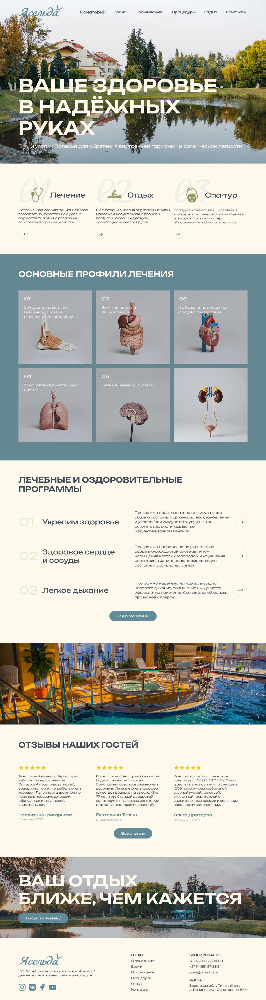
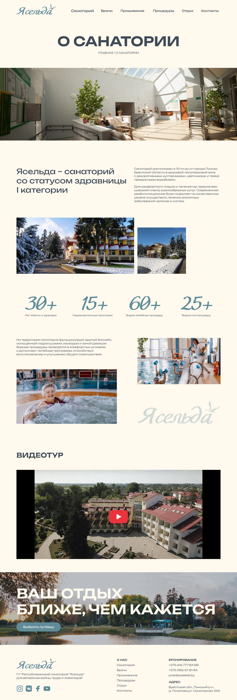
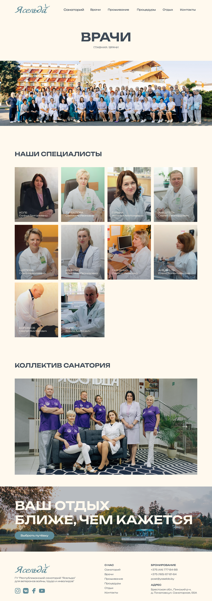
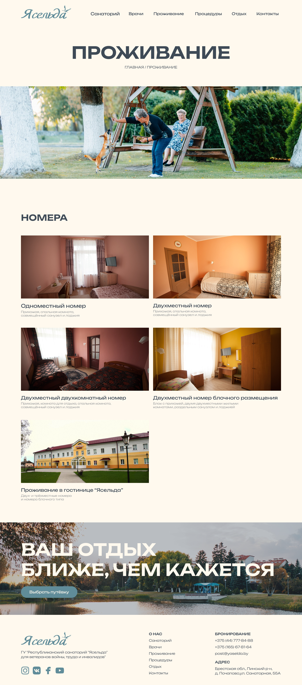
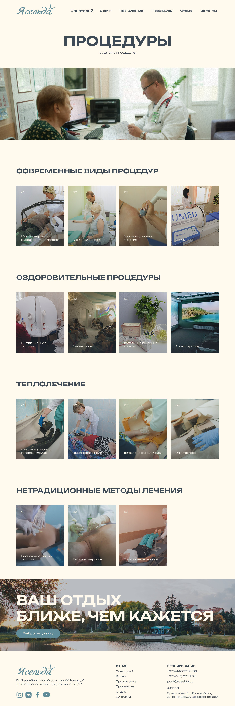
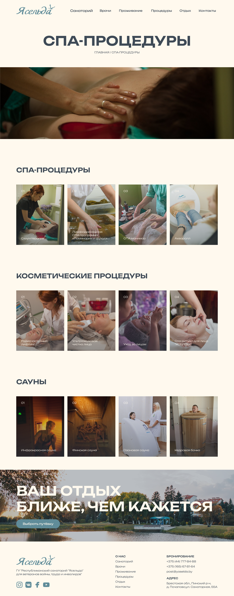
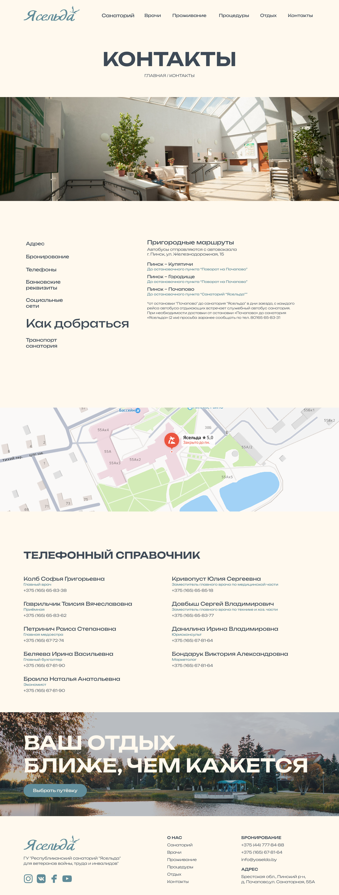
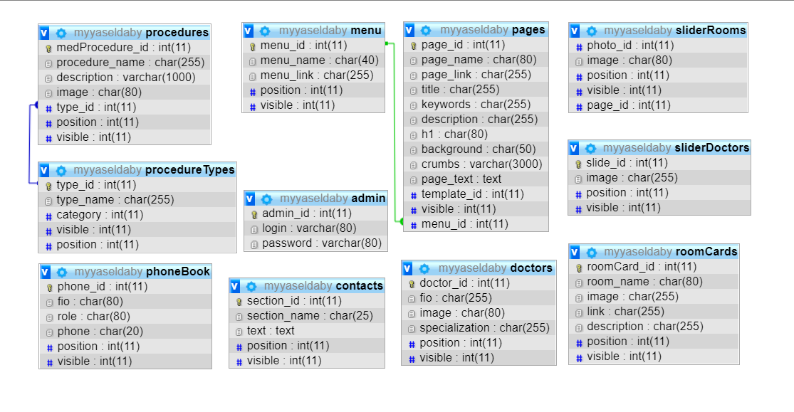

# Сайт санатория «Ясельда»

**Сайт санатория «Ясельда»** – учебный проект, выполненный в рамках курсовой работы в университете. Проект представляет собой редизайн существующего сайта санатория «Ясельда« (https://yaselda.by/) с обновлённой структурой страниц и пользовательским интерфейсом.

  

## О проекте

Цель проекта – разработать обновлённую версию сайта санатория, обеспечивающую удобное представление информации об услугах, специалистах, вариантах проживания и контактах.

## Используемые технологии

- HTML5
- CSS3
- JavaScript
- PHP
- MySQL

Информация на страницах формируется динамически на основе данных из базы данных и HTML-шаблонов.

## Основные возможности

- Просмотр информации о санатории.
- Просмотр списка врачей и информации о специалистах.
- Просмотр вариантов проживания и карточек номеров.
- Ознакомление с медицинскими процедурами.
- Просмотр SPA-процедур.
- Просмотр контактной информации и телефонного справочника.

## Страницы сайта

### Главная страница

### О санатории

### Врачи

### Номера для проживания

### Медицинские процедуры

### SPA-процедуры

### Контакты

## Структура проекта

| Папка / файл | Назначение |
|---|---|
| `files/` | Дополнительные файлы проекта |
| `fonts/` | Шрифты |
| `includes/` | PHP-функции |
| `sanat-images/` | Изображения, используемые на страницах сайта |
| `templates/` | HTML-шаблоны страниц и блоков |
| `database/` | SQL-файл структуры базы данных |
| `page-screenshots/` | Скриншоты страниц сайта |
| `index.php` | Основной файл сайта |
| `style.css` | Стили оформления |
| `script.js` | JavaScript |
| `config.example.php` | Пример конфигурации проекта |
| `connect.example.php` | Пример подключения к базе данных |

## База данных

В проекте используется MySQL.

